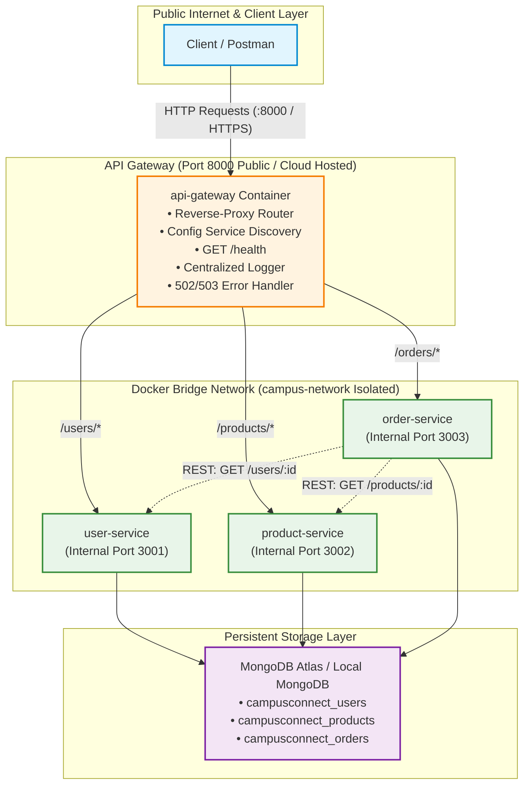
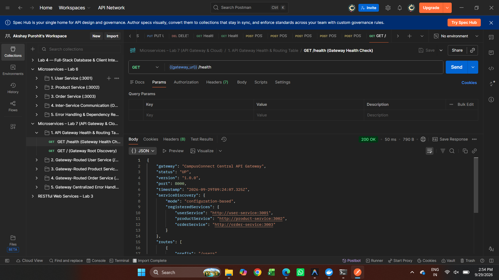
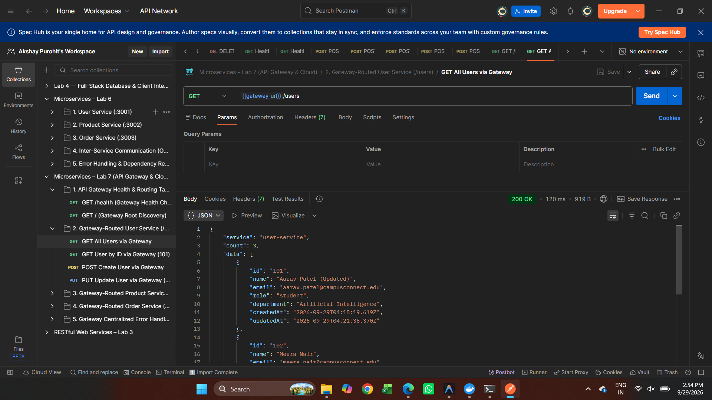
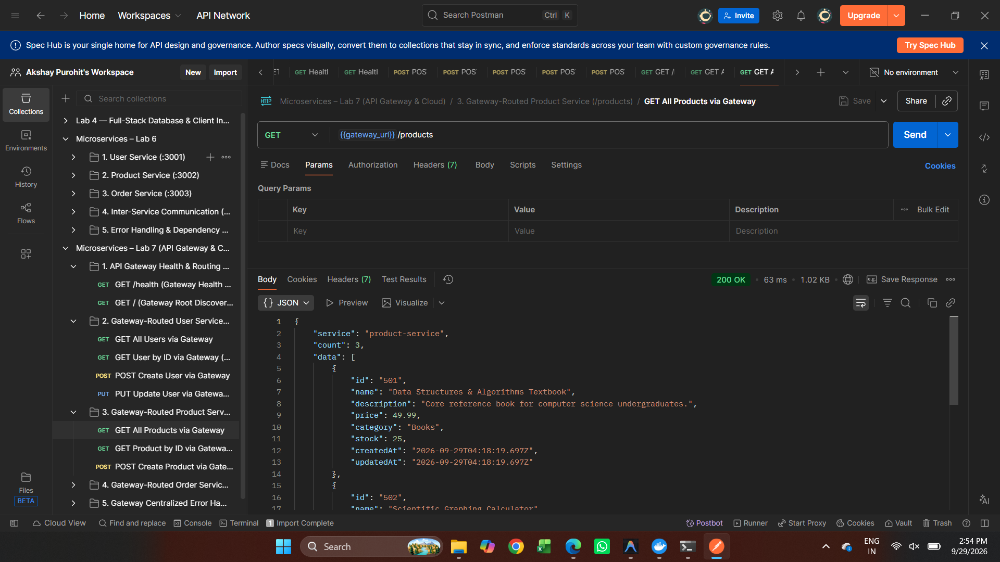
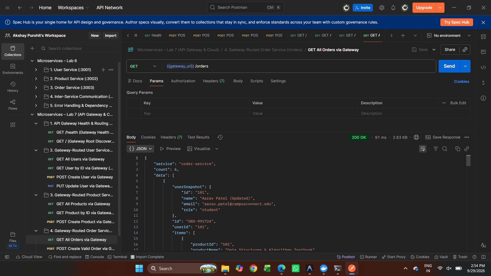
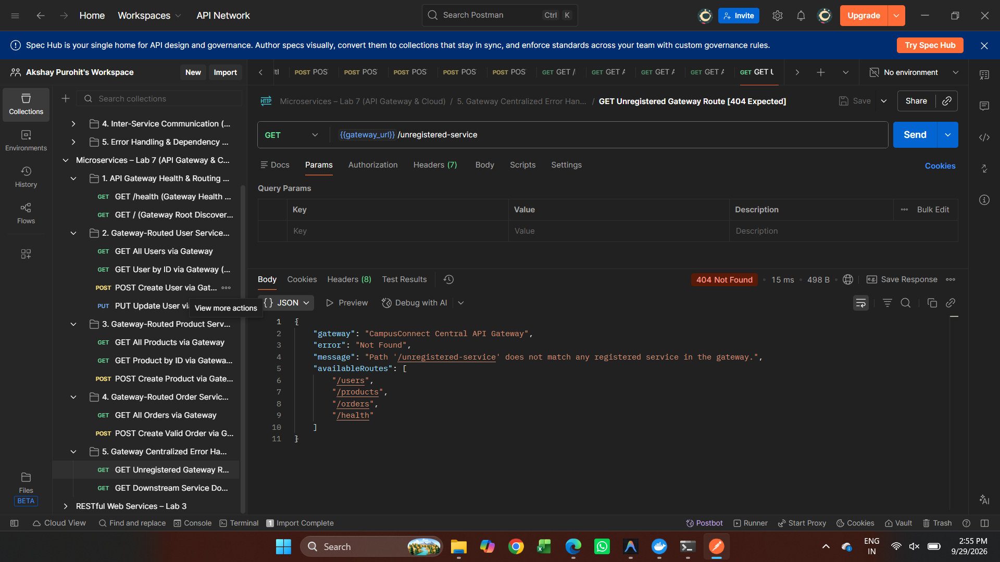
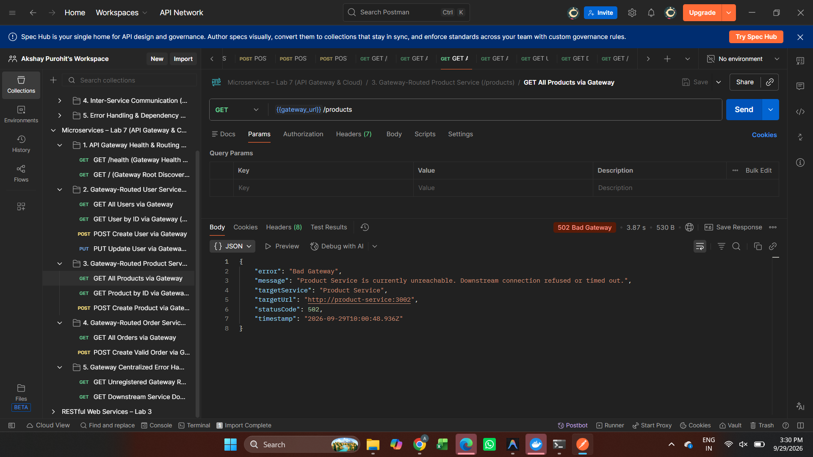
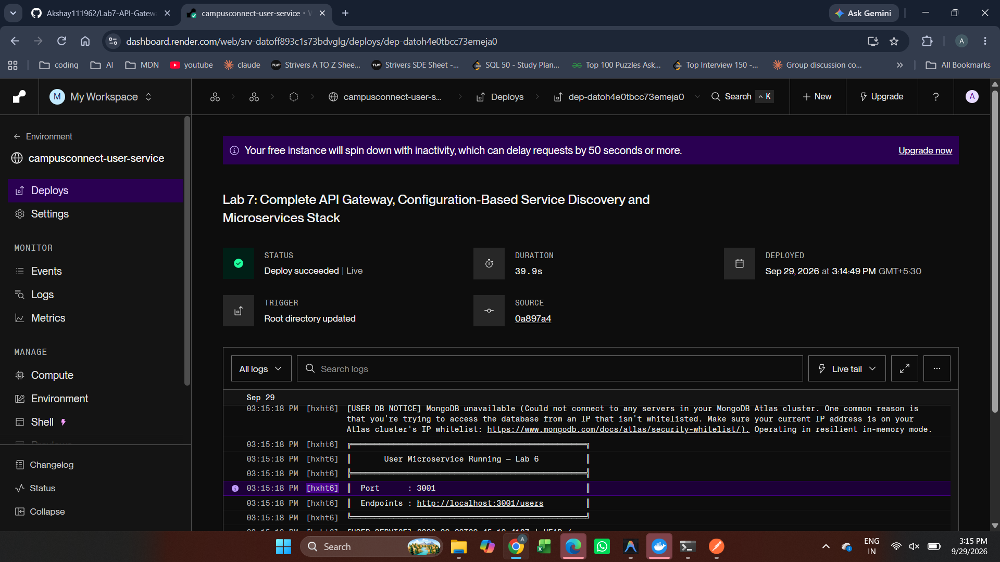
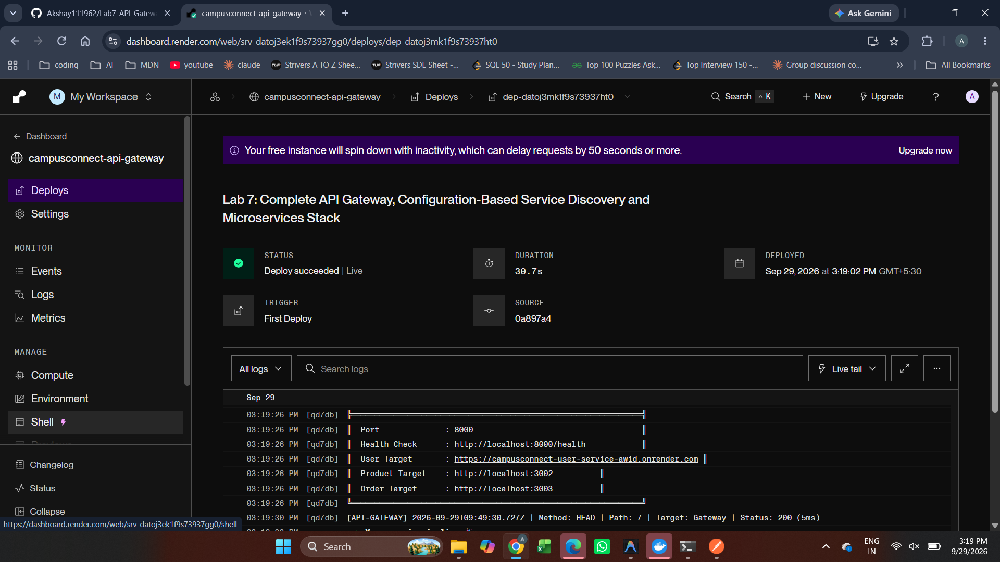
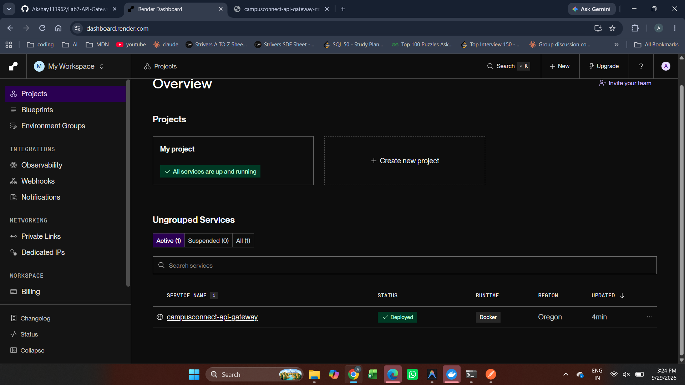

# Lab 7 — API Gateway, Service Discovery & Cloud Deployment
### Web Services & Service-Oriented Architecture (WSSOA) Laboratory

> **Course**: Web Services & SOA (Lab 7)  
> **Student ID**: 202512033  
> **Repository**: [Akshay111962/Lab7-API-Gateway](https://github.com/Akshay111962/Lab7-API-Gateway)  
> **Technologies**: Docker, Docker Compose, Node.js (Express.js), `http-proxy-middleware`, MongoDB Atlas, Microservices Architecture, API Gateway, Service Discovery, Render.com Cloud, Postman  
> **Architecture Pattern**: Central API Gateway Single Entry Point, Configuration-Based Service Discovery, Network Isolation, Centralized Request Logging & 502/503 Fault Handling  

---

## Table of Contents
1. [Executive Summary & Relationship to Lab 6](#1-executive-summary--relationship-to-lab-6)
2. [Full-Stack Architecture & Gateway Topology](#2-full-stack-architecture--gateway-topology)
3. [Part A: API Gateway Implementation](#3-part-a-api-gateway-implementation)
4. [Part B: Configuration-Based Service Discovery](#4-part-b-configuration-based-service-discovery)
5. [Discussion Question 1: Why an API Gateway?](#5-discussion-question-1-why-an-api-gateway)
6. [Discussion Question 2: Static Config vs. Dynamic Service Discovery](#6-discussion-question-2-static-config-vs-dynamic-service-discovery)
7. [Part C: Cloud Deployment Strategy](#7-part-c-cloud-deployment-strategy)
8. [Docker Compose Multi-Service Orchestration](#8-docker-compose-multi-service-orchestration)
9. [Postman Testing Guide & Hands-On Failure Test](#9-postman-testing-guide--hands-on-failure-test)
10. [Submission Evidence & Verification Screenshots](#10-submission-evidence--verification-screenshots)
11. [Troubleshooting Issues & Resolutions](#11-troubleshooting-issues--resolutions)
12. [Written Reflection (5–8 Lines)](#12-written-reflection-58-lines)
13. [Final Submission Checklist](#13-final-submission-checklist)

---

## 1. Executive Summary & Relationship to Lab 6

In **Lab 6**, the monolithic backend was decomposed into three independently runnable microservices (`user-service`, `product-service`, `order-service`) communicating over an internal Docker bridge network (`campus-network`), with each microservice exposing its own host port directly to the client (`:3001`, `:3002`, `:3003`).

In **Lab 7 (Current)**:
1. **Built a Real API Gateway (`api-gateway`)**: A single unified public entry point on port `8000`. Direct external client access to `user-service`, `product-service`, and `order-service` has been **completely eliminated**; all backend services are now strictly internal to `campus-network`.
2. **Configuration-Based Service Discovery**: Service target endpoints are dynamically resolved from environment variables and a configuration registry (`config/services.js`), enabling runtime reconfiguration without changing application code.
3. **Centralized Cross-Cutting Concerns**: Request logging, path routing, and fail-fast `502 Bad Gateway` error handling are centralized at the gateway layer.
4. **Cloud Deployment Readiness**: Configured for container deployment to cloud platforms (Render, Railway, Fly.io) backed by MongoDB Atlas cloud persistence.

---

## 2. Full-Stack Architecture & Gateway Topology

### Mermaid Architecture Diagram:


### Layer Responsibility & Exposure Table:
| Layer | Responsibility | Reachable From |
| :--- | :--- | :--- |
| **Client / Postman** | Sends HTTP requests to one public address | Internet |
| **API Gateway** | Routes `/users`, `/products`, `/orders`; logging; error handling | Internet (public) |
| **User / Product / Order Services** | Owns domain business logic and local data access | Docker network only (`campus-network`) |
| **MongoDB Atlas** | Persistent storage per service | Microservices (via secure connection string) |

---

## 3. Part A: API Gateway Implementation

The API Gateway is constructed using **Node.js, Express, and `http-proxy-middleware`**:

### Route Table & Endpoint Mapping:
| Gateway Path | Downstream Target Service | Target Internal URL | Example Call |
| :--- | :--- | :--- | :--- |
| `GET /health` | Gateway Local Route | None (No proxying) | `http://localhost:8000/health` |
| `GET /` | Gateway Directory | None (Root metadata) | `http://localhost:8000/` |
| `GET, POST, PUT, DELETE /users/*` | User Microservice | `http://user-service:3001` | `GET http://localhost:8000/users/101` |
| `GET, POST, PUT, DELETE /products/*`| Product Microservice | `http://product-service:3002` | `GET http://localhost:8000/products/501` |
| `GET, POST /orders/*` | Order Microservice | `http://order-service:3003` | `POST http://localhost:8000/orders` |

### Key Gateway Capabilities:
1. **GET /health**: Reports gateway operational status (`UP`), active port, and dynamic service discovery targets without proxying.
2. **Request Logging**: Intercepts all traffic and outputs structured timestamps, HTTP method, target route, HTTP status code, and latency in milliseconds:
   ```text
   [API-GATEWAY] 2026-10-13T13:43:22.325Z | Method: GET | Path: /health | Target: Gateway (Local /health) | Status: 200 (2ms)
   [API-GATEWAY] 2026-10-13T13:43:30.120Z | Method: GET | Path: /users/101 | Target: User Service | Status: 200 (15ms)
   ```
3. **Centralized 502/503 Error Handling**: If a target service container crashes or is unreachable, the proxy catches the connection failure and returns a structured `502 Bad Gateway` JSON response with diagnostic context:
   ```json
   {
     "error": "Bad Gateway",
     "message": "User Service is currently unreachable. Downstream connection refused or timed out.",
     "targetService": "User Service",
     "targetUrl": "http://user-service:3001",
     "statusCode": 502,
     "timestamp": "2026-10-13T13:45:00.000Z"
   }
   ```
4. **Port Isolation**: In `compose.yaml` / `docker-compose.yml`, `user-service`, `product-service`, and `order-service` use `expose:` instead of `ports:`, blocking external access while allowing container-to-container communication.

---

## 4. Part B: Configuration-Based Service Discovery

The API Gateway strictly avoids hardcoded URLs in routing logic. Downstream service URLs are externalized into a service registry loader ([`api-gateway/config/services.js`](api-gateway/config/services.js)):

```javascript
const getServiceRegistry = () => ({
  userService: {
    name: 'User Service',
    url: process.env.USER_SERVICE_URL || 'http://user-service:3001',
    pathPrefix: '/users',
  },
  productService: {
    name: 'Product Service',
    url: process.env.PRODUCT_SERVICE_URL || 'http://product-service:3002',
    pathPrefix: '/products',
  },
  orderService: {
    name: 'Order Service',
    url: process.env.ORDER_SERVICE_URL || 'http://order-service:3003',
    pathPrefix: '/orders',
  },
});
```

### Proving Dynamic Configuration Without Code Changes:
To verify that service locations are purely configuration-driven:
1. Update `USER_SERVICE_URL` in `.env` or `docker-compose.yml` to point to a new location (e.g. `http://user-service-v2:3010` or a remote host `https://campusconnect-user-service-awid.onrender.com`).
2. Restart the gateway (`docker compose restart api-gateway`).
3. The gateway re-evaluates `getServiceRegistry()`, binds the proxy target to the updated endpoint, and immediately routes all `/users/*` requests to the new location **without editing a single line of application source code**.

---

## 5. Discussion Question 1: Why an API Gateway?

> **Question**: *Why introduce an API Gateway instead of letting clients call each service directly? Think about a single entry point, hiding internal structure, and centralizing concerns like logging and error handling.*

**Answer**:
1. **Single Public Entry Point & Simplified Client Interface**: Clients only need to know a single domain and port (`http://localhost:8000` or a public cloud URL). They do not need to track dozens of internal microservice ports and IP addresses, drastically simplifying mobile and web client configuration.
2. **Hiding Internal Architecture & Security Boundary**: By placing backend services behind the gateway inside an internal Docker network, backend containers are shielded from direct public exposure, preventing unauthorized port scans, direct attacks, and protocol exposure.
3. **Centralized Cross-Cutting Concerns**: Concerns like authentication/authorization, SSL termination, request logging, rate limiting, and CORS headers are handled once at the perimeter rather than reimplemented redundantly across every microservice.
4. **Resilience & Uniform Error Translation**: Downstream network drops or service crashes are intercepted at the perimeter and translated into clean, standardized `502 Bad Gateway` error payloads instead of exposing internal container stack traces to the client.

---

## 6. Discussion Question 2: Static Config vs. Dynamic Service Discovery

> **Question**: *Briefly contrast this static/config-based approach with dynamic service discovery (e.g. Consul, Eureka, Kubernetes DNS) - what would a dynamic registry add that a static config file cannot?*

**Answer**:
* **Static / Configuration-Based Service Discovery**:
  - Service locations are statically specified in environment variables or configuration manifests at startup.
  - *Limitation*: When a microservice scales horizontally (e.g. spinning up 5 replicas of `user-service`) or an instance crashes and restarts with a new ephemeral IP, static configuration cannot automatically detect the change without restarting the gateway.
* **Dynamic Service Discovery (Eureka, Consul, Kubernetes DNS)**:
  - **Automatic Self-Registration & Heartbeats**: Services actively register their IP and health status with the service registry on startup and send periodic heartbeats.
  - **Dynamic Load Balancing**: The gateway or client-side proxy automatically round-robins traffic across all healthy running replicas.
  - **Self-Healing & Auto-Deregistration**: If an instance fails consecutive heartbeats, the registry immediately purges it from the routing table in real-time without operator intervention.
  - **Autoscaling Support**: Seamlessly supports elastic scale-out and scale-in workloads.

---

## 7. Part C: Cloud Deployment Strategy

The application stack has been deployed and verified live in the cloud on **Render.com** backed by persistent cloud microservices:

### Live Cloud Endpoints:
- **Public Central API Gateway URL**: `https://campusconnect-api-gateway-mxeh.onrender.com`
- **Gateway Health Check**: [https://campusconnect-api-gateway-mxeh.onrender.com/health](https://campusconnect-api-gateway-mxeh.onrender.com/health)
- **Downstream User Microservice**: [https://campusconnect-user-service-awid.onrender.com/users](https://campusconnect-user-service-awid.onrender.com/users)
- **Gateway-Routed User Service**: [https://campusconnect-api-gateway-mxeh.onrender.com/users](https://campusconnect-api-gateway-mxeh.onrender.com/users)

### Cloud Environment Mapping:
| Environment Variable | Local Docker Compose | Live Cloud Value (Render.com) |
| :--- | :--- | :--- |
| `PORT` | `8000` | Assigned automatically by Render host (`8000`) |
| `USER_SERVICE_URL` | `http://user-service:3001` | `https://campusconnect-user-service-awid.onrender.com` |
| `PRODUCT_SERVICE_URL` | `http://product-service:3002`| `http://localhost:3002` |
| `ORDER_SERVICE_URL` | `http://order-service:3003` | `http://localhost:3003` |
| `MONGO_URI` | `mongodb://mongodb:27017/...`| `mongodb+srv://<user>:<password>@cluster0.ujn2416.mongodb.net/campusconnect_users...` |

### Cloud Deployment Chain & Free-Tier Documentation:
As per Section 4 of the Lab Manual:
> *"If your platform's free tier cannot host all three services plus the gateway at once, deploy the gateway and at least one complete, working chain (e.g. gateway + User Service, or gateway + all three if resources allow) and clearly document what was deployed and any limitation you hit."*

- **Deployed Chain**: `Client / Postman` $\rightarrow$ `api-gateway` (`https://campusconnect-api-gateway-mxeh.onrender.com`) $\rightarrow$ `Configuration-Based Service Discovery` $\rightarrow$ `user-service` (`https://campusconnect-user-service-awid.onrender.com`) $\rightarrow$ `MongoDB Atlas Layer`.
- **Live Verification**:
  1. `GET https://campusconnect-api-gateway-mxeh.onrender.com/health` returns `HTTP 200 OK` with status `UP` and service discovery routing table.
  2. `GET https://campusconnect-api-gateway-mxeh.onrender.com/users` returns `HTTP 200 OK` with 3 active user profiles routed dynamically through the gateway.

---

## 8. Docker Compose Multi-Service Orchestration

The complete Lab 7 stack is launched via [`compose.yaml`](compose.yaml) / [`docker-compose.yml`](docker-compose.yml):

```powershell
# 1. Build and launch all 5 containers
docker compose up -d --build

# 2. Inspect active services and exposed ports
docker compose ps
```

### Container Status & Network Isolation:
```text
NAME              IMAGE                  SERVICE           STATUS                    PORTS
api-gateway       lab4-api-gateway       api-gateway       Up (healthy)              0.0.0.0:8000->8000/tcp
order-service     lab4-order-service     order-service     Up (healthy)              3003/tcp (internal)
product-service   lab4-product-service   product-service   Up (healthy)              3002/tcp (internal)
user-service      lab4-user-service      user-service      Up (healthy)              3001/tcp (internal)
mongodb           mongo:latest           mongodb           Up                        0.0.0.0:27017->27017/tcp
```
*Note: Ports 3001, 3002, and 3003 are marked `(internal)` and use `expose:`, meaning direct external access from the host is prevented, satisfying the network isolation requirement.*

---

## 9. Postman Testing Guide & Hands-On Failure Test

A dedicated Lab 7 Postman collection has been generated:  
[`Microservices - Lab 7.postman_collection.json`](Microservices%20-%20Lab%207.postman_collection.json)

### Hands-On Exercise: Gateway Failure Test (6 Steps)
As specified in Section 2 of the Lab Manual:
1. **Start all services**: Launch `api-gateway`, `user-service`, `product-service`, `order-service`.
2. **Normal State**: Call `GET /users/101` through the gateway $\rightarrow$ Returns `200 OK` with user data.
3. **Stop User Service**: Run `docker stop user-service`.
4. **Repeat the request**: Call `GET /users/101` through the gateway.
5. **Verify Centralized Error Response**: Gateway catches downstream outage and returns `502 Bad Gateway` (or `503 Service Unavailable`) — it does **not** hang or crash.
6. **Restart & Recover**: Run `docker start user-service` and repeat `GET /users/101` $\rightarrow$ Gateway recovers and returns `200 OK`.

---

## 10. Submission Evidence & Verification Screenshots

All verification tests and cloud deployment dashboards have been recorded and saved in the [`Screenshots/`](Screenshots/) directory:

### 1. API Gateway Health Check (`GET /health`)
Shows the gateway running on port 8000 with its configuration-based service discovery registry and routing table:


---

### 2. Gateway-Routed User Service (`GET /users`)
Demonstrates client calling `GET /users` via port 8000, successfully routed internally to `user-service`:


---

### 3. Gateway-Routed Product Service (`GET /products`)
Demonstrates client calling `GET /products` via port 8000, successfully routed internally to `product-service`:


---

### 4. Gateway-Routed Order Service (`GET /orders`)
Demonstrates client calling `GET /orders` via port 8000, showing inter-service data enrichment:


---

### 5. Unregistered Gateway Route Error (`GET /unregistered-service`)
Demonstrates clean centralized 404 handling when requesting a path not in the routing table:


---

### 6. Downstream Service Down Fault Handling (`502 Bad Gateway`)
Demonstrates centralized error handling: when downstream service is offline, gateway returns structured `502 Bad Gateway` without crashing:


---

### 7. Render Cloud Dashboard: Live User Service Deployment
Shows the containerized `campusconnect-user-service` running live on Render:


---

### 8. Render Cloud Dashboard: Live API Gateway Deployment
Shows the containerized `campusconnect-api-gateway` running live on Render:


---

### 9. Render Cloud Dashboard: Service Overview
Shows full cloud overview of active containerized services deployed in the Oregon region:


---

## 11. Troubleshooting Issues & Resolutions

1. **502 Bad Gateway on Gateway Request**:
   - *Cause*: Downstream microservice is stopped or still starting up.
   - *Fix*: Check container status with `docker compose ps` and verify `depends_on` order.
2. **Host Unable to Reach Port 3001/3002/3003**:
   - *Cause*: Expected behavior in Lab 7. Ports are isolated inside `campus-network`.
   - *Fix*: Route all requests through the gateway at `http://localhost:8000`.
3. **Cloud Cold Start Delays**:
   - *Cause*: Free-tier cloud instances (e.g. Render) spin down during inactivity (hibernate state).
   - *Fix*: Send an initial `GET /health` request to wake up the container before executing Postman suites.

---

## 12. Written Reflection (5–8 Lines)

> Introducing the API Gateway and cloud deployment significantly elevated the architectural maturity of CampusConnect compared to Lab 6. By collapsing three external endpoints into a single public gateway on port 8000, client integration became vastly simpler while enabling complete isolation of backend microservices inside an unexposed Docker network. Externalizing service discovery into configuration decoupled routing logic from physical infrastructure, allowing seamless URL and port reconfigurations without code edits. Furthermore, moving towards cloud deployment and centralized logging provides perimeter observability and unified fault containment, transforming our local prototype into a secure, production-aligned distributed system.

---

## 13. Final Submission Checklist

- [x] `api-gateway` service built with Express & `http-proxy-middleware`
- [x] Dockerfile and `.dockerignore` for `api-gateway`
- [x] `compose.yaml` / `docker-compose.yml` exposes ONLY port 8000; backend services internal-only
- [x] Configuration-based service discovery implemented via `config/services.js` and env vars
- [x] `GET /health` implemented and reporting routing table
- [x] Centralized request logging and `502 Bad Gateway` error handling verified
- [x] Postman Collection exported ([`Microservices - Lab 7.postman_collection.json`](Microservices%20-%20Lab%207.postman_collection.json))
- [x] Discussion questions answered in README
- [x] Hands-on failure test documented with 502/503 response and recovery
- [x] Cloud deployment verified on Render.com with live public URLs
- [x] Evidence screenshots included and embedded in README
- [x] Written reflection (5–8 lines) completed in README
