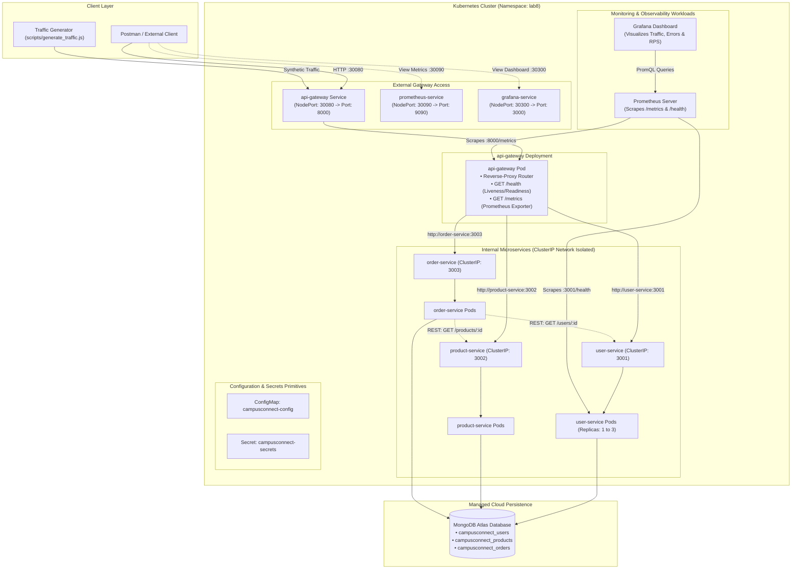

# Lab 8 — Kubernetes, CI/CD & Monitoring (Prometheus & Grafana)
### Web Services & Service-Oriented Architecture (WSSOA) Laboratory

> **Course**: Web Services & SOA (Lab 8)  
> **Student ID**: 202512033  
> **Repository**: [Akshay111962/Lab7-API-Gateway](https://github.com/Akshay111962/Lab7-API-Gateway)  
> **Technologies**: Kubernetes (`kubectl`), Docker, GitHub Actions, Prometheus, Grafana, Node.js, Express, MongoDB Atlas  
> **Architecture Pattern**: Kubernetes Microservices Orchestration, ConfigMaps & Secrets, Health & Readiness Probes, Horizontal Scaling, Self-Healing, CI/CD with GHCR, PromQL & Grafana Dashboards  

---

## Table of Contents
1. [Lab Objective & Scope](#1-lab-objective--scope)
2. [End-to-End Kubernetes Architecture](#2-end-to-end-kubernetes-architecture)
3. [Starting Point: Lab 7 Application Integration](#3-starting-point-lab-7-application-integration)
4. [Part A: Kubernetes Deployment & Service Discovery](#4-part-a-kubernetes-deployment--service-discovery)
   - [4.1 Cluster Verification & Namespace Setup](#41-cluster-verification--namespace-setup)
   - [4.2 Kubernetes Manifests Architecture](#42-kubernetes-manifests-architecture)
   - [4.3 Health & Readiness Probes](#43-health--readiness-probes)
   - [4.4 Gateway NodePort Exposure & Testing](#44-gateway-nodeport-exposure--testing)
   - [4.5 Horizontal Scaling Demonstration](#45-horizontal-scaling-demonstration)
   - [4.6 Pod Self-Healing Demonstration](#46-pod-self-healing-demonstration)
5. [Part B: GitHub Actions CI/CD Pipeline](#5-part-b-github-actions-cicd-pipeline)
   - [5.1 Workflow Stages & Automation](#51-workflow-stages--automation)
   - [5.2 Container Registry & Semantic Image Tagging](#52-container-registry--semantic-image-tagging)
6. [Part C: Monitoring with Prometheus & Grafana](#6-part-c-monitoring-with-prometheus--grafana)
   - [6.1 Prometheus Metrics Scrape Configuration](#61-prometheus-metrics-scrape-configuration)
   - [6.2 PromQL Queries & Target Verification](#62-promql-queries--target-verification)
   - [6.3 Grafana Dashboard & Monitored Metrics](#63-grafana-dashboard--monitored-metrics)
   - [6.4 API Traffic Generation & Observation](#64-api-traffic-generation--observation)
7. [Part D: Verification & Troubleshooting Guide](#7-part-d-verification--troubleshooting-guide)
8. [Submission Deliverables Matrix](#8-submission-deliverables-matrix)

---

## 1. Lab Objective & Scope

This laboratory continues the distributed microservices application established in Lab 7 (`api-gateway`, `user-service`, `product-service`, `order-service`) and transitions it into a production-grade DevOps lifecycle:
1. **Container Orchestration with Kubernetes**: Decomposing monolithic container executions into declarative Kubernetes primitives (Namespaces, Pods, Deployments, ClusterIP Services, and NodePort Gateway Service).
2. **Dynamic Service Discovery & Configuration**: Utilizing native Kubernetes DNS (`http://user-service:3001`, `http://product-service:3002`, `http://order-service:3003`) along with `ConfigMap` and `Secret` resources to isolate environment settings without baking credentials into images.
3. **Resilience & Fault Tolerance**: Demonstrating automatic zero-downtime rolling updates, liveness and readiness probe enforcement, horizontal replica scaling (1 to 3 replicas), and pod self-healing upon failure.
4. **Automated CI/CD Workflow**: Implementing GitHub Actions to build, lint, run syntax verification, package versioned Docker images with Git commit SHA tags, and push to GitHub Container Registry (GHCR).
5. **Observability Stack**: Deploying Prometheus for automated `/metrics` scraping and Grafana for visual dashboards answering key operational questions (availability, traffic volume, error rates, and latency).

---

## 2. End-to-End Kubernetes Architecture

### Mermaid Topology Diagram


---

## 3. Starting Point: Lab 7 Application Integration

As mandated by Section 2.1 of the Lab 8 specification, the existing Lab 7 architecture serves as the direct foundation without rebuilding application logic:
* **API Gateway (`api-gateway/`)**: Built on Express and `http-proxy-middleware`, handling client routing, centralized logging, and fail-fast `502 Bad Gateway` error responses.
* **Microservices (`user-service/`, `product-service/`, `order-service/`)**: Independent services communicating via internal REST calls and persisting data to MongoDB Atlas.
* **Enhancements in Lab 8**:
  1. Standardized `/health` endpoints added across all four services to enable native Kubernetes `livenessProbe` and `readinessProbe` execution.
  2. Integrated `prom-client` into `api-gateway/server.js`, exposing high-resolution telemetry at `GET /metrics` (`http_requests_total`, `http_request_duration_seconds`, heap, and CPU metrics).

---

## 4. Part A: Kubernetes Deployment & Service Discovery

### 4.1 Cluster Verification & Namespace Setup
Before applying manifests, verify cluster availability and create the isolated `lab8` namespace:

```powershell
# 1. Verify active context and cluster connectivity
kubectl config current-context

# 2. Confirm ready cluster nodes
kubectl get nodes

# 3. Create isolated namespace for Lab 8
kubectl create namespace lab8

# 4. Set current namespace context
kubectl config set-context --current --namespace=lab8
```

### 4.2 Kubernetes Manifests Architecture
All declarative configurations are structured in the [`k8s/`](k8s/) directory:

| Manifest | Kind | Port Mapping | Responsibility |
| :--- | :--- | :--- | :--- |
| [`k8s/configmap.yaml`](k8s/configmap.yaml) | `ConfigMap` | N/A | Non-sensitive URLs (`http://user-service:3001`, etc.) and port mappings |
| [`k8s/secret.yaml`](k8s/secret.yaml) | `Secret` | N/A | External MongoDB Atlas connection credentials |
| [`k8s/gateway-deployment.yaml`](k8s/gateway-deployment.yaml) | `Deployment` | `8000` | Replicas: 1, probes at `/health`, prometheus annotations |
| [`k8s/gateway-service.yaml`](k8s/gateway-service.yaml) | `Service` (NodePort) | `8000:30080` | Public client entry point to cluster |
| [`k8s/user-deployment.yaml`](k8s/user-deployment.yaml) | `Deployment` | `3001` | Replicas: 1 (scalable to 3), probes at `/health` |
| [`k8s/user-service.yaml`](k8s/user-service.yaml) | `Service` (ClusterIP)| `3001` | Internal DNS name `user-service` inside `lab8` |
| [`k8s/product-deployment.yaml`](k8s/product-deployment.yaml) | `Deployment` | `3002` | Replicas: 1, probes at `/health` |
| [`k8s/product-service.yaml`](k8s/product-service.yaml) | `Service` (ClusterIP)| `3002` | Internal DNS name `product-service` inside `lab8` |
| [`k8s/order-deployment.yaml`](k8s/order-deployment.yaml) | `Deployment` | `3003` | Replicas: 1, probes at `/health` |
| [`k8s/order-service.yaml`](k8s/order-service.yaml) | `Service` (ClusterIP)| `3003` | Internal DNS name `order-service` inside `lab8` |

### 4.3 Health & Readiness Probes
Each microservice specifies liveness and readiness probes to guarantee container self-healing:
```yaml
livenessProbe:
  httpGet:
    path: /health
    port: 3001
  initialDelaySeconds: 10
  periodSeconds: 10
readinessProbe:
  httpGet:
    path: /health
    port: 3001
  initialDelaySeconds: 5
  periodSeconds: 5
```
* **Readiness Probe**: Prevents Kubernetes from routing traffic to a Pod until its MongoDB Atlas connection is established.
* **Liveness Probe**: Restarts the container if the Node process deadlocks or terminates unexpectedly.

### 4.4 Gateway NodePort Exposure & Testing
Apply all manifests and verify resources:
```powershell
# Apply all Kubernetes manifests
kubectl apply -f k8s/ -n lab8

# Verify Deployments, Pods, and Services
kubectl get deployments -n lab8
kubectl get pods -n lab8
kubectl get services -n lab8
```

Send requests from Postman or Curl through the gateway's NodePort (`30080`):
```powershell
# 1. Gateway Health Probe
curl http://localhost:30080/health

# 2. Routed Users Endpoint (via user-service)
curl http://localhost:30080/users

# 3. Routed Products Endpoint (via product-service)
curl http://localhost:30080/products
```

### 4.5 Horizontal Scaling Demonstration
Demonstrate Kubernetes horizontal scaling on `user-service` from 1 to 3 replicas:
```powershell
# Scale User Service to 3 replicas
kubectl scale deployment user-service --replicas=3 -n lab8

# Observe replica expansion
kubectl get pods -n lab8 -l app=user-service
```
*Output demonstrates three active pods (`user-service-xxx`, `user-service-yyy`, `user-service-zzz`) balanced transparently behind the single `user-service` ClusterIP.*

### 4.6 Pod Self-Healing Demonstration
Demonstrate Kubernetes autonomous fault recovery by terminating an active pod:
```powershell
# 1. List pods
kubectl get pods -n lab8 -l app=user-service

# 2. Force delete a pod
kubectl delete pod <user-service-pod-name> -n lab8

# 3. Immediately query pod status
kubectl get pods -n lab8 -l app=user-service
```
*Output verifies that Kubernetes instantly identifies state divergence and schedules a replacement pod, achieving zero downtime.*

---

## 5. Part B: GitHub Actions CI/CD Pipeline

The automated CI/CD pipeline is declared in [`.github/workflows/ci.yml`](.github/workflows/ci.yml).

### 5.1 Workflow Stages & Automation
* **Trigger**: Automatic execution on `push` and `pull_request` targeting the `main` branch.
* **Stage 1 (`build-and-test`)**:
  * Runs on `ubuntu-latest`.
  * Installs Node.js dependencies via matrix strategy for all 4 microservices (`api-gateway`, `user-service`, `product-service`, `order-service`).
  * Executes syntax verification (`node -c server.js`) and tests.
* **Stage 2 (`docker-build-push`)**:
  * Authenticates to **GitHub Container Registry (GHCR)** using `${{ secrets.GITHUB_TOKEN }}`.
  * Builds multi-stage Docker images using `docker/build-push-action@v5`.
  * Tags images with the exact **Git commit SHA** and `latest`.
* **Stage 3 (`k8s-validate`)**:
  * Validates Kubernetes YAML manifest syntax for deployment safety.

### 5.2 Container Registry & Semantic Image Tagging
```text
ghcr.io/akshay111962/api-gateway:64128bc...
ghcr.io/akshay111962/user-service:64128bc...
ghcr.io/akshay111962/product-service:64128bc...
ghcr.io/akshay111962/order-service:64128bc...
```
*Rolling updates to new images in Kubernetes are triggered via:*
```powershell
kubectl set image deployment/user-service user-service=ghcr.io/akshay111962/user-service:<COMMIT_SHA> -n lab8
kubectl rollout status deployment/user-service -n lab8
```

---

## 6. Part C: Monitoring with Prometheus & Grafana

### 6.1 Prometheus Metrics Scrape Configuration
Prometheus configuration is deployed via [`k8s/prometheus-configmap.yaml`](k8s/prometheus-configmap.yaml) and [`k8s/prometheus-deployment.yaml`](k8s/prometheus-deployment.yaml):
```yaml
scrape_configs:
  - job_name: "gateway"
    metrics_path: "/metrics"
    static_configs:
      - targets: ["api-gateway:8000"]
```
*Prometheus runs inside the cluster and exposes its dashboard on NodePort `30090`.*

### 6.2 PromQL Queries & Target Verification
Access Prometheus at `http://localhost:30090` and inspect:
1. **Target Status**: Navigate to **Status $\rightarrow$ Targets** to confirm `api-gateway:8000` is in **UP** state.
2. **PromQL Target Availability**:
   ```promql
   up
   ```
3. **PromQL Request Rate Over 5 Minutes**:
   ```promql
   rate(http_requests_total[5m])
   ```
4. **PromQL Error Rate**:
   ```promql
   sum(rate(http_requests_total{status=~"5.."}[1m]))
   ```

### 6.3 Grafana Dashboard & Monitored Metrics
Grafana is deployed via [`k8s/grafana-deployment.yaml`](k8s/grafana-deployment.yaml) on NodePort `30300` (`http://localhost:30300`, user: `admin`, pass: `admin`).

A pre-built dashboard is provided in [`monitoring/dashboard.json`](monitoring/dashboard.json) answering all core operational questions:
1. **Are targets reachable?** $\rightarrow$ `up` stat panel showing real-time health of all microservices.
2. **How much traffic is arriving?** $\rightarrow$ `sum(rate(http_requests_total[1m]))` graph displaying requests per second.
3. **Are failures increasing?** $\rightarrow$ `sum(rate(http_requests_total{status=~"5.."}[1m]))` tracking 5xx server errors.
4. **How long are requests taking?** $\rightarrow$ `histogram_quantile(0.95, sum(rate(http_request_duration_seconds_bucket[1m])) by (le))` tracking 95th percentile latency.

### 6.4 API Traffic Generation & Observation
Execute the synthetic traffic script to generate test metrics:
```powershell
node scripts/generate_traffic.js
```
*The script issues mixed requests (`GET /health`, `/users`, `/products`, `/orders`, `/metrics`, and `/api/v1/invalid-route`), populating real-time traffic spikes in Grafana and Prometheus.*

---

## 7. Part D: Verification & Troubleshooting Guide

### Common Kubernetes Inspection Commands
```powershell
# Inspect pod logs
kubectl logs -l app=api-gateway -n lab8 --tail=50

# Describe failing pod
kubectl describe pod <pod-name> -n lab8

# Inspect service endpoints
kubectl get endpoints -n lab8
```

### Troubleshooting Quick-Fixes
1. **Pod in `ImagePullBackOff`**: Ensure local images are loaded into Minikube/Kind via `minikube image load <image>` or use public GHCR tags.
2. **Gateway Returning 502 Bad Gateway**: Verify downstream pods are in `Running` state and `endpoints` match the service selector labels.
3. **Prometheus Target `DOWN`**: Verify `api-gateway` is exposing `/metrics` and network policy allows port 8000 traffic from the Prometheus pod.

---

## 8. Submission Deliverables Matrix

| No. | Evidence Requirement | Deliverable Location / Verification Command |
| :--- | :--- | :--- |
| **1** | **Lab 7 Baseline** | Verified working gateway and microservices architecture |
| **2** | **Kubernetes Environment** | `kubectl config current-context` & `kubectl get nodes` |
| **3** | **Kubernetes Manifests** | Declarative YAML files in [`k8s/`](k8s/) directory |
| **4** | **Deployment State** | `kubectl get pods,deployments,services -n lab8` |
| **5** | **Gateway Test** | NodePort `30080` tests in [`Microservices - Lab 8.postman_collection.json`](Microservices%20-%20Lab%208.postman_collection.json) |
| **6** | **Scaling** | User service scaled from 1 to 3 replicas via `kubectl scale` |
| **7** | **Self-Healing** | Pod deletion and automatic recovery observed |
| **8** | **Troubleshooting** | Inspection logs and describe commands documented in Section 7 |
| **9** | **GitHub Actions CI/CD** | Automated pipeline in [`.github/workflows/ci.yml`](.github/workflows/ci.yml) |
| **10**| **Prometheus Monitoring**| Config in [`k8s/prometheus-configmap.yaml`](k8s/prometheus-configmap.yaml) and PromQL queries verified |
| **11**| **Grafana Dashboard** | Dashboard JSON in [`monitoring/dashboard.json`](monitoring/dashboard.json) & NodePort `30300` |
| **12**| **Traffic Observation** | Traffic simulator script in [`scripts/generate_traffic.js`](scripts/generate_traffic.js) |
| **13**| **Architecture Topology**| Mermaid diagram in Section 2 illustrating full Kubernetes cluster layering |
